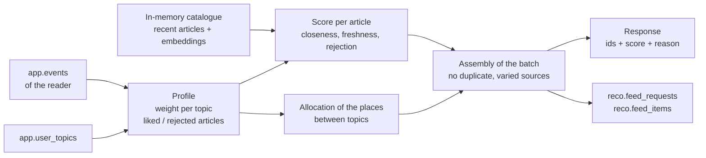

# Recommendation algorithm — specification v1

Working document for the team that codes the recommendation service. It replaces the first draft (schemas only). Read it with the backend/recommender contract (an internal document of the teams, shared outside git) and the [API reference of Swipread/api](https://github.com/Swipread/api/blob/main/docs/api.md), which are the reference for the exchanges: where they disagree with this document on an exchange format, they are right.

Section numbers are stable: the code refers to them ("spec 4.2").

## 1. Intent

Swipread is shown in a demo to a jury, without real readers. The jury grades the product and the technical quality of the algorithm. Two things must therefore be true:

- the feed visibly adapts to the interactions of a single person, live;
- we can explain why each card came out, figures included.

Hence the choice: a fully explicit model (weights per topic and a score formula), with no learning on volumes of data that do not exist.

### Goals

- The topics chosen at sign-up form the base of the feed; interactions make it evolve.
- A strong interaction on card n changes the feed from card n+10 on (stock rule decided with the backend; the current backend gives between n+11 and n+20, section 13), and the change is clear: the first recomputed card belongs to the topic just liked, unless a card of that topic already waits in the stock the backend kept (4.4).
- An unchosen topic that the reader hides without ever having liked it leaves the feed.
- Every card served is saved with the breakdown of its score.
- Quality is measured offline with simulated readers (section 11), which are also the acceptance tests.

### Out of scope

- A learned ranking model (LightGBM or other), popularity statistics, collaborative filtering, A/B tests, a separate session vector. Section 14 says what we would do with them given traffic.
- Consent to personalisation (`app.users.personalization_consent_at`): it does not exist in the API, the service ignores it.
- The screen that shows the explanations to the jury. The service exposes the data (section 9); how to display it is to be decided.

### What would be a failure even if everything runs

- A card nobody can say why it came out.
- A politics article served right after a "not interested" on politics, an unchosen topic.
- A feed that shrinks to a single topic after a few likes.
- Two identical runs (same database, same clock, same seed) that give two different batches.

## 2. Overview



At each `POST /v1/recommendations` call, the service:

1. takes the reader's profile stored in `reco.user_profiles` if it is up to date, or rebuilds it by replaying their events from `app.events` (section 4, 8.6);
2. scores each candidate article (section 5);
3. allocates the places of the batch between topics according to the weights (section 6);
4. fills each place with the best article of the topic (section 7);
5. saves the batch and its explanation, then answers.

The profile remains a pure function of the history: the one `reco.user_profiles` keeps (contract v1.5) is only a copy, used only if it was computed on the same events, the same topics and the same parameters (8.6). Intended consequences: no race between the arrival of an event and the recomputation, replaying twice gives the same result, and changing a parameter recomputes every profile without a migration.

## 3. Vocabulary and input data

| Term | Definition |
| --- | --- |
| Topic | A row of `app.topics`. The list is finite; K is their number. |
| Chosen topic | A topic in `app.user_topics` for the reader, at the time of the request. |
| Main topic of an article | In `app.article_topics`, the topic of highest `confidence`; on a tie, the lowest `topic_id`. An article without a topic is never recommended. |
| Embedding | A vector of 384 numbers, of norm 1, that sums up the meaning of an article (section 8). |
| Batch | The list of articles returned by a call to `/v1/recommendations`. |
| Catalogue | The recommendable articles, kept in memory by the service (section 8). |

The `app` schema is the one the backend's migrations create (Swipread/api); [database.md](database.md) lists what the recommender reads from it and defines the four `reco` tables that belong to the service. The service reads `app` read-only, without exception, and writes to `reco`: exactly the rights of the `swipread_reco` role created by the backend (section 13).

The service depends on the ingestion for two things: articles in `app.articles` and at least one topic per article in `app.article_topics`. The backend has no article status: every article of an active source counts as active. It has no `cluster_id` either: the "same story" rule rests on similarity alone (7.2). Development relies on the synthetic catalogue of section 11 and on the backend's sample articles (section 13).

All numeric parameters are gathered in section 10. In the text they appear by name (`V_LIKE`, `EPSILON`…).

## 4. Reader profile

The profile holds three things: a weight per topic, the list of liked articles and the list of rejected articles.

### 4.1 Value of an article for the reader

For each (reader, article) pair, the events of type `view`, `open`, `read`, `like`, `unlike`, `save`, `unsave`, `share`, `hide` update a state:

| Event | Effect on the state |
| --- | --- |
| `view` with `dwellMs < T_SKIP` | `skipped = true` |
| `view` with `dwellMs ≥ T_LONG` | `long_view = true` |
| `view` in between | none |
| `open` | `opened = true` |
| `read` | `read = max(read, c)` with `c = min(1, readMs / expected_time)` and `expected_time = word_count / 230 × 60,000` ms. If `word_count` is zero or missing, `expected_time = 60,000`. `scrollDepth` does not enter the value and may be missing: the web app does not measure it. |
| `like` / `unlike` | `liked = true` / `liked = false` |
| `save` / `unsave` | `saved = true` / `saved = false` |
| `share` | `shared = true` |
| `hide` | `hidden = true` (final) |

`impression` is ignored, like any event without an article (`app.events.article_id` may be null). `word_count` comes from `app.articles`.

The value `v` of the article follows from the state:

```
if hidden:                          v = V_HIDE            (−0.15)
else:
    pos = max( V_LONG_VIEW if long_view,                 (0.02)
               V_OPEN if opened,                         (0.03)
               V_OPEN + V_READ_BONUS × read if read,     (0.03 to 0.07)
               V_LIKE if liked, saved or shared )        (0.08)
    if pos > 0:                     v = pos
    else if skipped:                v = V_SKIP            (−0.02)
    else:                           v = 0
```

An article therefore counts once, at the level of its strongest signal. A long view, an open, a read then a like on the same article are worth 0.08, not the sum.

### 4.2 Weight per topic

**Start.** With c topics chosen among K:

- each chosen topic gets `(1 − EPSILON) / c`;
- each unchosen topic gets `EPSILON / (K − c)`;
- if c = 0 or c = K, all get `1 / K`.

The weights sum to 1: a weight reads directly as a share of the feed.

**Update.** The reader's events are replayed from the oldest to the most recent (sorted by `occurred_at`, then `event_id`). At most the `EVENTS_MAX` most recent are replayed. For each event, the value of the article is computed before (`v_before`) and after (`v_after`); if `δ = v_after − v_before` is not zero, it is applied to the main topic `t` of the article:

```
if δ > 0:
    w[t] = w[t] + δ
else:
    floor = 0 if (type = hide and t not chosen) else W_FLOOR
    w[t] = max( w[t] + δ, min(w[t], floor) )
w = w / sum(w)            # renormalisation after each update
```

Related rules:

- An event whose article is unknown or has no main topic does not change the weights.
- If the sum drops to 0, the weights start again from the starting weights.
- Only a hide on an unchosen topic can bring a weight to 0, and it does so as soon as the weight is at most 0.15: that is the case of any unchosen topic the reader has not clearly liked before. An unchosen topic raised to 20 % by likes goes down to 5 % at the first hide, then to 0 at the second.
- A topic at 0 gets no place in the feed any more. It comes back if the reader adds it to their chosen topics, or interacts positively with an article of that topic met elsewhere than in the feed (fallback feed, saved list).
- A chosen topic never goes below `W_FLOOR`: the reader asked for it explicitly.
- Renormalising at each step dilutes old gains: recent interactions weigh more than old ones, and the responsiveness stays the same whatever the age of the account.
- If the reader changes their topics (`PUT /v1/me/topics`), nothing special: the next computation starts from the new chosen topics and replays the whole history.

**Worked example** (K = 10, chosen topics: tech, economy, culture; likes without any other signal):

| Step | tech, economy, culture (each) | sport | politics | 5 others (each) |
| --- | --- | --- | --- | --- |
| Start | 30.0 % | 1.4 % | 1.4 % | 1.4 % |
| Like on a sport article | 27.8 % | 8.7 % | 1.3 % | 1.3 % |
| Like on another sport article | 25.7 % | 15.5 % | 1.2 % | 1.2 % |
| Hide on a politics article | 26.0 % | 15.7 % | 0 % | 1.2 % |

Over 10 cards, that gives on average 7.8 cards of the chosen topics, 1.6 of sport, 0.6 of exploration and none of politics.

### 4.3 Liked and rejected articles

After the replay:

- **liked**: articles with `v > 0`, of strength `s = min(1, v / V_LIKE)`;
- **rejected**: articles with `v < 0`, of strength `s = 1` if hidden, `S_SKIP` if only skipped.

Each strength is multiplied by an age factor `0.5 ^ (age_days / HALF_LIFE_PROFILE_DAYS)`, the age counted from the last event on the article. At most `PROFILE_MAX_ITEMS` articles are kept per list, the most recent. Their embeddings are read from `reco.article_embeddings` (8.4), including for articles that left the catalogue; an article without an embedding of the current model, or gone from `app.articles`, is dropped from the list.

### 4.4 Echo topic

The **echo topic** is the main topic of the article of the most recent `like`, `save`, `share` or complete `read` event, among the events whose `received_at` is later than the reader's previous recommendation request (`max(generated_at)` in `reco.feed_requests`). If there is no such event, or if its topic has a zero weight, there is no echo. Section 6 uses it to put that topic first in the batch. `unlike`, `unsave` and `hide` never give an echo.

A `read` is complete exactly when the backend judges it strong (`StrongEventPolicy.java`): `scrollDepth > 0.8`, or `readMs`, truncated to an integer, at least 60 % of `word_count / 230 × 60,000` ms. If `word_count` is zero or unknown, only the first condition counts; a missing `readMs` counts as 0. The web app does not send `scrollDepth`, so in practice the second condition applies. The list is thus exactly the backend's strong positive events, those that trigger the recomputation of the stock: every recomputation caused by a positive signal has its echo. This is the only use of `scrollDepth`; the value of a read is still measured by time (4.1).

Exception: there is no echo if the stock the backend kept (the request's `exclude` list, rule 3 of the contract) already holds an article of that topic. After several strong signals in a row, every card served is the first of a new batch; without this exception the feed would shrink to the echo topic.

The eligibility of an event compares its `received_at`, set by the backend, with the `generated_at` of the previous request, set by the recommender: a clock offset between the two can lose an echo.

## 5. Score of an article

### 5.1 Similarity between two articles

The raw embeddings of any two articles already have a high cosine. They are therefore recentred:

```
sim(a, b) = clamp( (cos(a, b) − MU) / (1 − MU), 0, 1 )
```

`MU` is the mean cosine between two articles drawn at random from the catalogue. It is recomputed at each reload of the catalogue, on 2,000 pairs drawn with a fixed seed (0). If the catalogue has fewer than 50 articles, `MU = 0`.

### 5.2 The three terms

For a candidate `a`:

- **Closeness**: compute `s_j × sim(a, j)` for each liked article `j` and take the mean of the `min(3, number of liked)` largest values. Without a liked article, closeness is 0.
- **Rejection**: the maximum of `s_j × sim(a, j)` over the rejected articles `j`. Without a rejected article, 0.
- **Freshness**: `0.5 ^ (age_hours / HALF_LIFE_FRESH_HOURS)`, the age counted from `published_at` and floored at 0.

Closeness is computed over all liked articles, all topics together: liking an article about AI also brings closer an economy article about AI.

### 5.3 Score

```
raw(a)   = W_AFF × closeness + W_FRESH × freshness − W_NEG × rejection
score(a) = clamp( raw(a), 0, 1 )
```

Ranking uses `raw`, which can be negative: clamping before ranking would tie all penalised articles. `score` is the value returned in the response and saved.

Ranking: `raw` descending, then `published_at` descending, then `id` ascending. As long as the reader has liked nothing, freshness alone ranks the articles.

## 6. Allocation of the places between topics

### 6.1 Shares

Start from the weights `w`. No topic exceeds `P_MAX` of the batch: if a weight exceeds it, bring it back to `P_MAX` and spread the excess over the other topics in proportion to their weights, repeating until none exceeds. If all the others are at 0, do not cap. `p[t]` are the resulting shares. The cap does not change the weights, only the allocation.

### 6.2 Order of the topics in the batch

The proportions must hold on each page of 10 cards, not only on the whole batch. The topics are therefore interleaved this way:

- each topic `t` of non-zero share gets an offset `u[t]` drawn uniformly in [0, 1); the echo topic gets `u = 0`;
- the k-th card of topic `t` (k = 0, 1, 2…) has the virtual rank `τ(t, k) = (k + u[t]) / p[t]`;
- places are given in increasing order of `τ`; on a tie, lowest `topic_id` first.

The stock the backend kept (`exclude`, 4.4) will be served right before the batch: its cards count as already placed. Each topic therefore starts at `k = number of cards of that topic in the stock` instead of 0, and the interleaving goes on instead of starting over. Without this rule, after several strong signals in a row, the reader would only see beginnings of batches and a page could hold 7 to 9 cards of one topic. Only the relative order of the `τ` matters: nothing else changes.

A topic at 30 % thus comes back every 3 or 4 cards. A topic at 1.4 % has a 14 % chance of appearing on a given page. The random offset keeps small topics from always being pushed to the end of the batch, where the batch is most often thrown away before being served.

The draws use `numpy.random.default_rng(seed)`, in increasing order of `topic_id`. The seed is the integer formed by the first 8 bytes of the SHA-256 of the `requestId`, shifted right by one bit to fit in a `bigint`; tests can impose it.

## 7. Assembly of the batch

### 7.1 Candidates

An article of the catalogue is a candidate if it meets all these conditions:

- its language is the reader's: the first two letters of `context.locale`, or failing that of `app.users.locale`;
- it is not in `exclude` (request);
- it is not in the Redis set `seen:{userId}`;
- the reader has no `app.user_articles` row for it, and no replayed event is about it.

If reading `seen:{userId}` fails, the service goes on with the other exclusions and logs a warning.

### 7.2 Filling

The places are visited in the order of section 6.2. For a place of topic `t`, take the best-ranked candidate of `t` that respects:

1. **not the same story** as an article already placed in the batch. Two articles cover the same story if they have the same non-null `cluster_id` or if `sim ≥ DUP_SIM`. The backend has no `cluster_id` column: the service always leaves it null, and similarity alone counts. The code keeps the `cluster_id` comparison, used by the tests and the simulation, for the day the ingestion produces some;
2. **varied sources**: among the 9 articles placed just before, at most `SOURCE_MAX − 1` come from the same source (that is at most `SOURCE_MAX` per window of 10).

Two additions to these rules:

- **liked or rejected articles**: a candidate that covers the same story as a liked or rejected article of the profile (4.3) is never placed. Only `sim ≥ DUP_SIM` is compared here, the `cluster_id` of these articles not being loaded. Without it, right after a like, closeness would put first the same story told by another outlet;
- **kept stock**: the cards of `exclude`, in the request's order, count as placed before position 0. They mark their stories before the filling (rule 1), and the window of the 9 previous articles starts filled with the sources of the stock's last 9 cards (rule 2). The reader sees them just before the batch: without this, both rules would only hold inside the batch, not in the feed actually served.

If no candidate of `t` respects both rules, take the best-ranked one that respects rule 1 alone (and mark it `relaxedSource`). If there is none either, the topic is exhausted: this place and the topic's next ones are skipped, which spreads its places over the others in proportion.

Stop when the batch holds `count` articles or all topics are exhausted. The batch can therefore be shorter than asked for, which the contract allows.

### 7.3 The `reason` field

| Value | Condition |
| --- | --- |
| `similar` | closeness ≥ `AFF_REASON_MIN` |
| `onboarding` | otherwise, and the main topic is a chosen topic |
| `explore` | otherwise |

`collaborative` and `trending` are never sent in v1.

## 8. Service

### 8.1 General shape

Python 3.12, FastAPI, psycopg 3, redis-py, numpy, sentence-transformers. Two processes from the same package:

- **api**: serves `POST /v1/recommendations` and the explanation routes; keeps the catalogue in memory;
- **worker**: encodes new articles, writes the fallback lists, purges, and keeps the profiles up to date from the `events` stream (8.6).

The computation (profile, score, allocation, assembly) is written as pure functions, without access to the database, Redis or the clock: these dependencies are passed as arguments. This is what makes the tests of section 11 possible without infrastructure.

### 8.2 In-memory catalogue

The api process loads the articles that meet: an embedding of the current model in `reco.article_embeddings`, `published_at` within the last `MAX_AGE_DAYS` days, an active source, a main topic. For each: id, source, language, `published_at`, main topic, embedding (`cluster_id` is null, 7.2). Full reload every `CATALOG_REFRESH_S` seconds in the background, with atomic replacement.

At this scale (a few thousand articles), similarities are computed exactly with a numpy matrix product. The recommender does not use pgvector's HNSW index.

If the catalogue is empty, the service answers 200 with `items: []` and the backend serves the fallback feed.

### 8.3 `POST /v1/recommendations`

Request and response formats: those of the contract, unchanged.

- `requestId`: `r_` followed by a UUID v4 in hexadecimal.
- `modelVersion`: `topic-weights-v1`.
- `items`: in display order (the assembly's), not by score.
- 400 if the request is invalid; 404 if `userId` does not exist in `app.users`; 503 if the database is unreachable.

A new reader who has topics therefore gets a real batch from their first call, built on their starting weights. The 404 only concerns users that do not exist.

Latency target: 95 % of complete responses (reading the events, computing, saving the batch) under 150 ms with 5,000 articles in the catalogue and 300 events for the reader; the backend gives up at 300 ms. The computation alone must take under 80 ms (test A13). If saving the batch makes the target slip, it moves to a background task after the response is sent.

### 8.4 Encoding of the articles (worker)

Every `ENCODE_INTERVAL_S` seconds, the worker takes up to 64 articles of `app.articles` that have no row of the current model in `reco.article_embeddings` (no row, or a row of another model), the most recently ingested first.

- Model: `intfloat/multilingual-e5-small` (384 dimensions), on CPU.
- Encoded text: `query: {title}. {summary}`, HTML tags removed from the summary, truncated to 512 tokens.
- Vector normalised to 1, written to `reco.article_embeddings` (one row per article, replaced if it exists) with `model = 'multilingual-e5-small'` and `embedded_at`.

The recommender writes nothing to `app`: the backend's `swipread_reco` role only has `SELECT` there (section 13). The backend's `app.articles.embedding` column is neither read nor written by the recommender. An article becomes recommendable at most `ENCODE_INTERVAL_S + CATALOG_REFRESH_S` seconds after its ingestion, encoding time aside.

### 8.5 Fallback lists (worker)

Every 10 minutes, for each topic: the 50 most recent articles of active sources (`published_at` descending) whose main topic it is, published within the last `MAX_AGE_DAYS` days, written to the Redis list `fallback:{slug}` with a TTL of 1 hour. The replacement is atomic (written to a temporary key, then `RENAME`).

### 8.6 The `events` stream and stored profiles

Contract v1.5. The worker reads the Redis stream `events` in the consumer group `reco`, under a stable name (`RECO_STREAM_CONSUMER`, `worker` by default), in batches of 100, waiting at most 2 seconds between two activities. The group is created at the start of the stream if it does not exist: the first run handles the messages still kept (7 days).

- **A reader's event** (types read by the profile, 4.1): their profile is recomputed once per batch from `app.events`, not from the message, then stored in `reco.user_profiles` with its mark. Replaying from the source of truth makes the handling idempotent and insensitive to the order of arrival: a message received twice or late gives the same profile. `impression` and unknown types are acknowledged without work; an unreadable message is logged and acknowledged.
- **`user_deleted`**: the reader's profile and batches (`reco.feed_requests`, and `reco.feed_items` by cascade) are deleted at once. A reader absent from `app.users` has no stored profile either.
- **Acknowledgement**: a profile whose recomputation fails is acknowledged anyway, the next request will recompute it. A deletion that fails stays pending and is taken again every minute (`XREADGROUP` from `0`), like the messages read before a crash; the hourly purge (8.7) erases the same data as a safety net.

What is stored (`reco.user_profiles`, [database.md](database.md)): the result of the replay (4.2, 4.3), that is the weights, the liked and rejected articles with their strength before the age factor, the touched articles and the last 50 weight changes. The age factor (4.3) and the echo topic (4.4) depend on the time and on the previous request: they are computed at each request, the echo on the events received since the previous request only.

**At each request** (`POST /v1/recommendations`, `GET /v1/explain/users/{userId}`), the stored profile is used only if:

- its mark is that of the reader's events in `app.events` (profile types, with an article): number of events, and last event (`occurred_at`, `event_id`) as the contract asks. The number also catches an event committed late with an `occurred_at` older than the mark;
- its basis is the same: model version, parameters (section 10), list of topics and chosen topics. A change of topics (`PUT /v1/me/topics`) publishes no message: it is seen here.

Otherwise the profile is replayed from `app.events` (mark and events read in one snapshot) and stored. This covers the case v1 feared: the backend asks for a batch right after a strong event, often before the worker has read its message; the request sees the mark is behind and replays. Lost messages (stream trimmed at 7 days, Redis emptied) are covered the same way.

### 8.7 Purge (worker)

Every hour: deletion of the `reco.feed_requests` rows older than 30 days, and of those whose `user_id` no longer exists in `app.users`. The `feed_items` follow by cascade. The profiles (`reco.user_profiles`) of readers absent from `app.users` are deleted in the same pass, as a safety net behind `user_deleted` (8.6). The `reco.article_embeddings` rows whose article no longer exists in `app.articles` are deleted in the same pass. The recommender keeps no other personal data.

## 9. Explanation and traceability

### 9.1 Tables

At start, the service creates its four tables, `reco.feed_requests`, `reco.feed_items`, `reco.article_embeddings` (8.4) and `reco.user_profiles` (8.6), if they do not exist. The `reco` schema and the `vector` extension come from the backend's migrations: the recommender's role cannot create a schema, and the service stops with an explicit message if they are missing, or if `reco.user_profiles` is still the backend's old table (created by its migration V1, dropped by V8). Their definition is in [database.md](database.md). Content of the `jsonb` columns:

- `profile`: `{ "weights": {slug: weight}, "shares": {slug: share after the cap}, "likedCount": n, "rejectedCount": n, "echoTopic": slug or null, "mu": value }`.
- `params`: the parameters of section 10 as used for this batch.
- `explanation`: `{ "affinity": x, "freshness": x, "penalty": x, "topicWeight": x, "nearestLiked": [{ "articleId": …, "sim": x }] (3 at most), "nearestRejected": { "articleId": …, "sim": x } or null, "relaxedSource": bool }`.

### 9.2 Read routes

On the recommendation service, in JSON, without authentication: the service is only reachable from the internal network.

| Route | Content |
| --- | --- |
| `GET /v1/explain/users/{userId}` | Topics (id, slug, label, chosen or not, weight, share), liked and rejected articles with their strength, and the last 50 events that changed a weight: type, article, topic, δ, weight of the topic after. |
| `GET /v1/explain/requests/{requestId}` | The `feed_requests` row and its `feed_items`, with the title of each article. |
| `GET /healthz` | Status of the service, size and age of the catalogue. |

## 10. Parameters

All in a single configuration module (`params.py`), overridable by environment variables (`RECO_<NAME>`).

| Name | Value | Role |
| --- | --- | --- |
| `EPSILON` | 0.10 | Total share of the unchosen topics at start |
| `W_FLOOR` | 0.01 | Floor of a weight, except a hide on an unchosen topic |
| `P_MAX` | 0.60 | Largest share of a topic in a batch |
| `T_SKIP` | 1,500 ms | Below it, the card is skipped |
| `T_LONG` | 6,000 ms | Above it, a long view |
| `V_SKIP` | −0.02 | Value of a skipped article |
| `V_LONG_VIEW` | 0.02 | Long view |
| `V_OPEN` | 0.03 | Open |
| `V_READ_BONUS` | 0.04 | Added to `V_OPEN`, in proportion to the read |
| `V_LIKE` | 0.08 | Like, save or share |
| `V_HIDE` | −0.15 | Hide |
| `S_SKIP` | 0.15 | Strength of a skipped article in the rejected list |
| `HALF_LIFE_PROFILE_DAYS` | 30 | Half-life of the liked and rejected articles |
| `PROFILE_MAX_ITEMS` | 100 | Largest size of each list |
| `EVENTS_MAX` | 5,000 | Most events replayed |
| `W_AFF` | 0.6 | Weight of closeness in the score |
| `W_FRESH` | 0.4 | Weight of freshness |
| `W_NEG` | 0.5 | Weight of rejection |
| `HALF_LIFE_FRESH_HOURS` | 48 | Half-life of freshness |
| `MAX_AGE_DAYS` | 14 | Largest age of a recommendable article |
| `DUP_SIM` | 0.80 | "Same story" threshold |
| `SOURCE_MAX` | 2 | Articles of one source per window of 10 |
| `AFF_REASON_MIN` | 0.20 | Smallest closeness for `reason = similar` |
| `CATALOG_REFRESH_S` | 60 | Reload period of the catalogue |
| `ENCODE_INTERVAL_S` | 15 | Encoding period |

`DUP_SIM` and `AFF_REASON_MIN` depend on the embedding model: they are to be checked on real articles now that the ingestion is in place (about twenty pairs judged by hand are enough).

## 11. Evaluation with simulated readers

### 11.1 Synthetic catalogue

To test without a model or a database: 10 topics, 3 subtopics per topic, 8 sources. Each topic has a centre drawn at random on the unit sphere in dimension 384; each subtopic is `normalise(topic centre + 0.6 × noise)`; each article is `normalise(subtopic centre + 0.7 × noise)`, the noise being a Gaussian vector of norm 1. With these values, two articles of the same subtopic have a similarity of about 0.65: enough to be brought together, not enough to pass for the same story. 60 articles per subtopic, sources given in turn, fixed seed.

### 11.2 Acceptance tests

All deterministic (seed and clock imposed). The bounds of A1, A2 and A4 hold for the seed the tests impose: from one seed to another, the random offsets of 6.2 move the number of cards of a topic by about 2 cards either way around its share. Unless stated otherwise, the articles all have the same age (24 h), and the reader chose 3 topics out of 10.

| # | Scenario | Expected |
| --- | --- | --- |
| A1 | New reader, batch of 50 | Between 40 and 48 cards of the chosen topics; each chosen topic has between 13 and 17 cards |
| A2 | Two likes on two articles of an unchosen topic X, then a hide on an article of an unchosen topic Y; batch of 50 | Weights equal to those of the example in 4.2 within 0.001; position 0 of the batch in topic X; no card of Y; at least 6 of the first 10 in the chosen topics |
| A3 | Five likes on five articles of an unchosen topic | Weight of the topic ≥ 0.30 |
| A4 | Twenty likes on one topic, batch of 50 | Computed share of the topic equal to `P_MAX`; at most 31 cards of the topic in the batch with the imposed seed (30 expected); at least 3 topics present |
| A5 | Three likes on subtopic S of a chosen topic T | Among the cards of T in the next batch, at least 70 % are of S |
| A6 | Hide on an article of subtopic S of a chosen topic T | The weight of T goes down and stays ≥ `W_FLOOR`; among the cards of T in the next batch, at most 15 % are of S |
| A7 | Long view, open, complete read then like on one article | Total gain of the topic before renormalisation equal to `V_LIKE`, not the sum |
| A8 | Like then `unlike` on an article without any other signal | Value of the article back to 0 |
| A9 | Twenty successive batches, each added to `seen` | No article twice; no article of `exclude` returned |
| A10 | Batch of 50 | No "same story" pair; at most 2 articles per source in any window of 10 |
| A11 | Same state, same seed, same clock, two calls | Identical batches |
| A12 | Articles of various ages, reader without interaction | Within each topic, output from the most recent to the oldest |
| A13 | 5,000 articles, 300 events, 200 calls of the pure computation (no database nor Redis) | 95 % under 80 ms (performance test, run apart) |

### 11.3 Report for the jury

A script plays 4 typical readers over 100 cards each, imitating the backend (pages of 10, the n+10 stock rule decided with the backend; the current backend differs, section 13), and produces a table per reader and per page of 10:

- share of relevant cards (within the simulated reader's stated tastes);
- share of the favourite topic;
- share of exploration (`reason = explore`);
- number of distinct topics and sources.

Typical readers: faithful to their chosen topics; passionate about an unchosen topic; allergic to a chosen topic; a reader who skips everything. Each reader follows a fixed rule (likes such subtopic, hides such topic, skips the rest). Output in Markdown and CSV.

## 12. What is left to the coding team

- The organisation of the modules, as long as the core stays in pure functions (8.1).
- The SQL queries and how the catalogue is loaded.
- The log format, packaging, containerisation.
- Unit tests beyond those of section 11.

## 13. State of the backend (Swipread/api, commit 7549cf5; stream, ingestion and schema at commit 48055c3)

What the backend really does on each point the recommender depends on, read in its code. Paths are relative to the Swipread/api repository. The backend is the reference: where it differs from what had been decided, the recommender adapts or the gap is reported.

| Point | What the backend does | For the recommender |
| --- | --- | --- |
| Stock kept on a strong event | Strong events: `like`, `save`, `share`, `hide`, and complete `read` (4.4) (`event/StrongEventPolicy.java`). On one of them, `FeedRefiller.invalidate` calls `FeedStore.trim(userId, pageSize)`: it keeps the first 10 articles of the stock, **whatever the position** of the card, then starts a refill. A `hide` also removes the article from the stock. | **Gap with the n+10 rule** decided (section 15, stock rule 4 of the contract), which kept the first `p` articles. With the cards still on the phone (9 − p) and the 10 kept, an interaction on card n shows between card n+11 (last card of the page) and n+20 (first card of the page), not at n+10. The simulation of section 11.3 still imitates the n+10 rule. |
| Refill after commit | `EventService.ingest` stores the events in a transaction, and only then invalidates the stock. The refill runs in the background, under the lock `feed:{userId}:lock` (5 s); a batch computed while a new invalidation changes `feed:{userId}:ver` is dropped and recomputed once. | Compliant: the replayed profile holds the event, the echo is not lost. |
| `exclude` | `FeedRefiller.refill` sends the current stock (`LRANGE feed:{userId} 0 -1`), in order, and `count = 50 − size of the stock`. | Compliant: the cards of `exclude` count as placed before the batch (7.2) and remove the echo (4.4). |
| `seen:{userId}` | Redis set of the articles served, extended at each page (`FeedStore.markSeen`, TTL 30 days). The backend also filters out the articles of the batch already in `seen`. | Compliant: the recommender reads it read-only (7.1). |
| `fallback:{slug}` | `FallbackFeedProvider` reads the `fallback:{slug}` lists of the reader's topics, shuffled, then completes with the most recent articles of the database. It never writes them. | Compliant: the worker writes them, keyed by slug (8.5). |
| Rights of the recommender in the database | Migration `V5__reco_role.sql`: group role `swipread_reco`, without login. `SELECT` on `app` (on `app.users`, only `id`, `locale`, `created_at`; nothing on `app.event_outbox` or `app.refresh_tokens`), `USAGE` and `CREATE` on the `reco` schema, read and write on its tables. No `UPDATE` on `app`, no `CREATE` on the database. The login role is created by operations: `CREATE ROLE reco_service LOGIN PASSWORD '…' IN ROLE swipread_reco`. | The recommender writes nothing to `app`: embeddings go to `reco.article_embeddings` (8.4). It does not create the `reco` schema (created by V1), only its tables (9.1). |
| Recommender client | `reco/HttpRecommendationClient` calls `POST {swipread.reco.base-url}/v1/recommendations` (default `http://localhost:8081`, variable `SWIPREAD_RECO_URL`, 300 ms timeout). The `mock-reco` profile replaces it with `MockRecommendationClient` (random articles); `dev` and `test` include `mock-reco` (`application.yaml`). | The backend only calls the real recommender when started without the `dev` and `test` profiles ([Getting started](getting-started.md#run-next-to-the-api)). Default port of the recommender: 8081. |
| `events` stream | Published by the backend through an outbox table (`V6__event_outbox.sql`, `OutboxRelay`) after writing to `app.events`: `XADD events MINID ~ (now - 7 d)`, one field `data` with the JSON of the message. In `dev`, `MockEventsConsumer` reads it in the group `mock-reco` and logs each message. `user_deleted` messages ask to erase the reader's profile and batches (contract v1.5). | Consumed by the worker in the group `reco` (8.6): profiles kept up to date in `reco.user_profiles`, data of a deleted account erased at once. |
| Ingestion | The backend's `ingestion` module (contract v1.5, disabled in `dev` and `test`): every 15 minutes, reads the feeds of the active sources that have topics, writes `app.articles` (`word_count` read from the article's page when it is readable) and `app.article_topics` (the 1 to 3 topics of the source, `confidence` 1.0, 0.9, 0.8 in the order of `app.source_topics`). In `dev`, nothing writes `app.articles` but the development data. `db/dev-data/R__2_sample_articles.sql` (`dev` profile) creates 300 sample articles of a single source ("Sample article n", in French, `published_at` spread over the 300 hours before the migration, one topic each, without embedding). `db/seed/R__1_topics.sql` creates 8 topics. | The worker encodes these 300 articles. A single source: the varied sources rule (7.2) is always relaxed. They leave the catalogue `MAX_AGE_DAYS` after the migration, which does not make them younger. Nearly identical titles give very close embeddings: the demo batches say nothing about the quality of the algorithm. |
| `app` schema | Migrations V1 to V8 (V8: `app.source_topics`, read state of `app.sources`, drop of `reco.user_profiles` and `reco.model_runs` created by V1). No `status`, `cluster_id`, `content_hash`, `embedding_model` or `embedded_at` on `app.articles`; `app.events.article_id` may be null; event type `unsave`. | Every article of an active source is active; `cluster_id` null (7.2); events without an article ignored and `unsave` read (4.1). The integration tests run on a copy of these migrations (`sql/app_schema.sql`), connected with a role member of `swipread_reco`. |

## 14. With real traffic

What v1 leaves out, and what would trigger adding it:

| Topic | What we would do | When |
| --- | --- | --- |
| Learned ranking | Train a model (LightGBM) to predict opening from the terms of the score, on `reco.feed_items` joined with `app.events`, correcting the position bias | A few tens of thousands of cards served |
| Popularity | Add a "read by many people" term and a `trending` reason | As soon as there are several hundred active readers |
| Collaborative filtering | Recommend what readers with close tastes liked (`reason = collaborative`) | Same |
| A/B test | Serve two `modelVersion` to two groups and compare the open rates | As soon as a change of algorithm competes with the existing one |
| Incremental profile | Apply each message of the `events` stream to the stored profile instead of replaying the history (today the stream triggers a full replay, 8.6) | When a reader's history goes beyond a few thousand events |
| Approximate search | Use pgvector's HNSW index instead of the exact in-memory computation | Catalogue beyond about 100,000 articles |
| Grouped interests | Sum up the liked articles in a few centres instead of keeping them all | When the liked lists go beyond a few hundred |

The data needed is already saved by v1: every card served, its position, its detailed score and the version of the algorithm.

## 15. Origin of the decisions

| Decision | Made by |
| --- | --- |
| Demo to a jury, visible adaptation, product and technique graded | Enzo |
| Service in Python, the API reference and the contract are the reference | Enzo |
| n+10 rule on the stock | Enzo, validated by William |
| One weight per topic, higher for the chosen topics, non-zero for the others, adjusted by the interactions, which gives the proportion shown | Enzo |
| Within a topic, output the articles closest to what the reader liked | Enzo |
| Dropping LightGBM, popularity, A/B tests, centroids, session vector; section "with real traffic" | Proposed by Claude, accepted by Enzo |
| Everything else: parameter values, additive update with renormalisation, floors, 60 % cap, single value per article, closeness to the 3 nearest, rejection term, freshness, interleaving with random offsets, echo topic, profile replayed from the database, in-memory catalogue, embedding model, explanation tables and routes, tests | Proposed by Claude, validated by Enzo |
