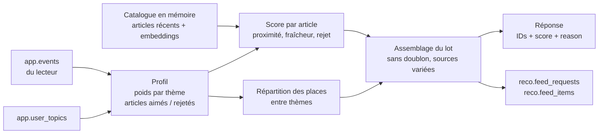

# Algorithme de recommandation — spécification v1

Document de travail pour l'équipe qui code le service de reco. Il remplace le premier jet (schémas seuls). Il se lit avec [Contrat backend reco.md](Contrat%20backend%20reco.md) et [api.md](api.md), qui font référence pour les échanges ; en cas de désaccord sur un format d'échange, ce sont eux qui ont raison.

## 1. Intention

Swipread est présenté en démo devant un jury, sans lecteurs réels. Le jury note le produit et la qualité technique de l'algo. Deux choses doivent donc être vraies :

- le fil s'adapte de façon visible aux interactions d'une seule personne, en direct ;
- on peut expliquer pourquoi chaque carte est sortie, chiffres à l'appui.

D'où le parti pris : un modèle entièrement explicite (des poids par thème et une formule de score), sans apprentissage sur des volumes de données qui n'existent pas.

### Objectifs

- Les thèmes choisis à l'inscription forment la base du fil ; les interactions la font évoluer.
- Une interaction forte sur la carte n change le fil à partir de la carte n+10 (section 13, règle du stock), et le changement est net : la première carte recalculée appartient au thème qui vient d'être aimé.
- Un thème non choisi que le lecteur masque sans l'avoir jamais aimé disparaît du fil.
- Chaque carte servie est enregistrée avec le détail de son score.
- La qualité se mesure hors ligne avec des lecteurs simulés (section 11), qui servent aussi de tests d'acceptation.

### Hors périmètre

- Modèle de classement appris (LightGBM ou autre), statistiques de popularité, filtrage collaboratif, A/B test, vecteur de session séparé. La section 14 dit ce qu'on en ferait avec du trafic.
- Le consentement à la personnalisation (`app.users.personalization_consent_at`) : il n'existe pas dans `api.md`, le service l'ignore.
- L'écran qui montre les explications au jury. Le service expose les données (section 9) ; leur affichage est à décider.

### Ce qui serait un échec même si tout tourne

- Une carte dont on ne sait pas dire pourquoi elle est sortie.
- Un article de politique servi juste après un « pas intéressé » sur la politique, thème non choisi.
- Un fil qui se réduit à un seul thème après quelques likes.
- Deux exécutions identiques (même base, même horloge, même graine) qui donnent deux lots différents.

## 2. Vue d'ensemble



À chaque appel `POST /v1/recommendations`, le service :

1. reconstruit le profil du lecteur en rejouant ses événements depuis `app.events` (section 4) ;
2. note chaque article candidat (section 5) ;
3. répartit les places du lot entre les thèmes selon les poids (section 6) ;
4. remplit chaque place avec le meilleur article du thème (section 7) ;
5. enregistre le lot et son explication, puis répond.

Le profil n'est pas stocké : c'est une fonction pure de l'historique. Conséquences voulues : pas de course entre l'arrivée d'un événement et le recalcul, rejouer deux fois donne le même résultat, et changer un paramètre recalcule tous les profils sans migration.

## 3. Vocabulaire et données d'entrée

| Terme | Définition |
| --- | --- |
| Thème | Une ligne de `app.topics`. La liste est finie ; on note K leur nombre. |
| Thème choisi | Thème présent dans `app.user_topics` pour le lecteur, au moment de la requête. |
| Thème principal d'un article | Dans `app.article_topics`, le thème de plus forte `confidence` ; à égalité, le plus petit `topic_id`. Un article sans thème n'est jamais recommandé. |
| Embedding | Vecteur de 384 nombres, de norme 1, qui résume le sens d'un article (section 8). |
| Lot | La liste d'articles renvoyée par un appel à `/v1/recommendations`. |
| Catalogue | Les articles recommandables, gardés en mémoire par le service (section 8). |

Le schéma de la base, pour `app` comme pour `reco`, est celui de [database.md](database.md), seul document qui fait foi sur ce sujet. Le service lit `app` en lecture seule (une exception, section 8) et écrit dans `reco`.

Le service dépend de l'ingestion pour trois choses : des articles dans `app.articles`, au moins un thème par article dans `app.article_topics`, et un `status` tenu à jour. `cluster_id` est facultatif : s'il est toujours nul, la règle « même actualité » repose sur la seule ressemblance (7.2). Tant que l'ingestion n'existe pas, le développement s'appuie sur le catalogue synthétique de la section 11.

Tous les paramètres chiffrés sont regroupés en section 10. Dans le texte ils apparaissent sous leur nom (`V_LIKE`, `EPSILON`…).

## 4. Profil du lecteur

Le profil contient trois choses : un poids par thème, la liste des articles aimés et la liste des articles rejetés.

### 4.1 Valeur d'un article pour le lecteur

Pour chaque couple (lecteur, article), les événements de type `view`, `open`, `read`, `like`, `unlike`, `save`, `share`, `hide` mettent à jour un état :

| Événement | Effet sur l'état |
| --- | --- |
| `view` avec `dwellMs < T_SKIP` | `zappé = vrai` |
| `view` avec `dwellMs ≥ T_LONG` | `vue_longue = vrai` |
| `view` entre les deux | aucun |
| `open` | `ouvert = vrai` |
| `read` | `lecture = max(lecture, c)` avec `c = min(1, readMs / durée_attendue)` et `durée_attendue = word_count / 230 × 60 000` ms. Si `word_count` est nul ou absent, `durée_attendue = 60 000`. `scrollDepth` n'entre pas dans la valeur. |
| `like` / `unlike` | `aimé = vrai` / `aimé = faux` |
| `save`, `share` | `sauvé = vrai`, `partagé = vrai` |
| `hide` | `masqué = vrai` (définitif) |

`impression` est ignoré. `word_count` vient de `app.articles`.

La valeur `v` de l'article se déduit de l'état :

```
si masqué :                         v = V_HIDE            (−0,15)
sinon :
    pos = max( V_LONG_VIEW si vue_longue,                (0,02)
               V_OPEN si ouvert,                         (0,03)
               V_OPEN + V_READ_BONUS × lecture si lu,    (0,03 à 0,07)
               V_LIKE si aimé, sauvé ou partagé )        (0,08)
    si pos > 0 :                    v = pos
    sinon si zappé :                v = V_SKIP            (−0,02)
    sinon :                         v = 0
```

Un article compte donc une seule fois, à la hauteur de son signal le plus fort. Vue longue, ouverture, lecture puis like sur le même article valent 0,08, pas la somme.

### 4.2 Poids par thème

**Départ.** Avec c thèmes choisis parmi K :

- chaque thème choisi reçoit `(1 − EPSILON) / c` ;
- chaque thème non choisi reçoit `EPSILON / (K − c)` ;
- si c = 0 ou c = K, tous reçoivent `1 / K`.

Les poids somment à 1 : un poids se lit directement comme une part du fil.

**Mise à jour.** Les événements du lecteur sont rejoués du plus ancien au plus récent (tri par `occurred_at`, puis `event_id`). On rejoue au plus les `EVENTS_MAX` plus récents. Pour chaque événement, on calcule la valeur de l'article avant (`v_avant`) et après (`v_après`) ; si `δ = v_après − v_avant` est non nul, on l'applique au thème principal `t` de l'article :

```
si δ > 0 :
    w[t] = w[t] + δ
sinon :
    plancher = 0 si (type = hide et t non choisi) sinon W_FLOOR
    w[t] = max( w[t] + δ, min(w[t], plancher) )
w = w / somme(w)          # renormalisation après chaque mise à jour
```

Règles associées :

- Un événement dont l'article est inconnu ou sans thème principal ne change pas les poids.
- Si la somme tombe à 0, on repart des poids de départ.
- Seul un masquage sur un thème non choisi peut amener un poids à 0, et il le fait dès que le poids est inférieur ou égal à 0,15 : c'est le cas de tout thème non choisi que le lecteur n'a pas nettement aimé auparavant. Un thème non choisi monté à 20 % par des likes redescend à 5 % au premier masquage, puis à 0 au second.
- Un thème à 0 ne reçoit plus de place dans le fil. Il revit si le lecteur l'ajoute à ses thèmes choisis, ou s'il interagit positivement avec un article de ce thème rencontré ailleurs que dans le fil (feed de repli, sauvegardés).
- Un thème choisi ne descend jamais sous `W_FLOOR` : le lecteur l'a demandé explicitement.
- La renormalisation à chaque étape dilue les gains anciens : les interactions récentes pèsent plus que les anciennes, et la réactivité reste la même quel que soit l'âge du compte.
- Si le lecteur modifie ses thèmes (`PUT /v1/me/topics`), rien de spécial : le prochain calcul part des nouveaux thèmes choisis et rejoue tout l'historique.

**Exemple chiffré** (K = 10, thèmes choisis : tech, économie, culture ; likes sans autre signal) :

| Étape | tech, éco, culture (chacun) | sport | politique | 5 autres (chacun) |
| --- | --- | --- | --- | --- |
| Départ | 30,0 % | 1,4 % | 1,4 % | 1,4 % |
| Like sur un article de sport | 27,8 % | 8,7 % | 1,3 % | 1,3 % |
| Like sur un autre article de sport | 25,7 % | 15,5 % | 1,2 % | 1,2 % |
| Masquage d'un article de politique | 26,0 % | 15,7 % | 0 % | 1,2 % |

Sur 10 cartes, cela donne en moyenne 7,8 cartes des thèmes choisis, 1,6 de sport, 0,6 d'exploration et aucune de politique.

### 4.3 Articles aimés et rejetés

Après le rejeu :

- **aimés** : articles avec `v > 0`, de force `s = min(1, v / V_LIKE)` ;
- **rejetés** : articles avec `v < 0`, de force `s = 1` si masqué, `S_SKIP` si seulement zappé.

Chaque force est multipliée par un facteur d'ancienneté `0,5 ^ (âge_jours / HALF_LIFE_PROFILE_DAYS)`, où l'âge se compte depuis le dernier événement sur l'article. On garde au plus `PROFILE_MAX_ITEMS` articles par liste, les plus récents. Leurs embeddings sont lus dans `app.articles`, y compris pour des articles sortis du catalogue ; un article sans embedding est écarté de la liste.

### 4.4 Thème en écho

Le **thème en écho** est le thème principal de l'article du plus récent événement `like`, `save`, `share` ou `read` avec `scrollDepth > 0,8`, parmi les événements dont `received_at` est postérieur à la précédente requête de reco du même lecteur (`max(generated_at)` dans `reco.feed_requests`). S'il n'y a pas de tel événement, ou si son thème a un poids nul, il n'y a pas d'écho. Il sert en section 6 à placer ce thème en tête du lot. La liste reprend exactement les événements forts positifs du contrat, ceux qui déclenchent le recalcul du stock : chaque recalcul provoqué par un signal positif a donc son écho. C'est le seul usage de `scrollDepth` ; la valeur d'une lecture reste mesurée par le temps (4.1).

Exception : il n'y a pas d'écho si le stock gardé par le backend (la liste `exclude` de la requête, règle 3 du contrat) contient déjà un article de ce thème. Après plusieurs signaux forts d'affilée, chaque carte servie est la première d'un nouveau lot ; sans cette exception, le fil se réduirait au thème en écho.

## 5. Score d'un article

### 5.1 Ressemblance entre deux articles

Les embeddings bruts de deux articles quelconques ont déjà un cosinus élevé. On recentre donc :

```
sim(a, b) = borne( (cos(a, b) − MU) / (1 − MU), 0, 1 )
```

`MU` est le cosinus moyen entre deux articles pris au hasard dans le catalogue. Il est recalculé à chaque rechargement du catalogue, sur 2 000 paires tirées avec une graine fixe (0). Si le catalogue compte moins de 50 articles, `MU = 0`.

### 5.2 Les trois termes

Pour un candidat `a` :

- **Proximité** : on calcule `s_j × sim(a, j)` pour chaque article aimé `j` et on prend la moyenne des `min(3, nombre d'aimés)` plus grandes valeurs. Sans article aimé, la proximité vaut 0.
- **Rejet** : le maximum de `s_j × sim(a, j)` sur les articles rejetés `j`. Sans article rejeté, 0.
- **Fraîcheur** : `0,5 ^ (âge_heures / HALF_LIFE_FRESH_HOURS)`, l'âge étant compté depuis `published_at` et borné à 0 par le bas.

La proximité se calcule sur tous les articles aimés, tous thèmes confondus : aimer un article sur l'IA rapproche aussi un article d'économie qui parle d'IA.

### 5.3 Score

```
brut(a)  = W_AFF × proximité + W_FRESH × fraîcheur − W_NEG × rejet
score(a) = borne( brut(a), 0, 1 )
```

Le classement se fait sur `brut`, qui peut être négatif : le borner avant de classer mettrait à égalité tous les articles pénalisés. `score` est la valeur renvoyée dans la réponse et enregistrée.

Classement : `brut` décroissant, puis `published_at` décroissant, puis `id` croissant. Tant que le lecteur n'a rien aimé, la fraîcheur seule classe les articles.

## 6. Répartition des places entre thèmes

### 6.1 Parts

On part des poids `w`. Aucun thème ne dépasse `P_MAX` du lot : si un poids dépasse, on le ramène à `P_MAX` et on répartit l'excédent entre les autres thèmes au prorata de leurs poids, en répétant jusqu'à ce qu'aucun ne dépasse. Si tous les autres sont à 0, on ne plafonne pas. On note `p[t]` les parts obtenues. Le plafond ne modifie pas les poids, seulement la répartition.

### 6.2 Ordre des thèmes dans le lot

Les proportions doivent tenir sur chaque page de 10 cartes, pas seulement sur le lot entier. On entrelace donc les thèmes ainsi :

- chaque thème `t` de part non nulle reçoit un décalage `u[t]` tiré uniformément dans [0, 1) ; le thème en écho reçoit `u = 0` ;
- la k-ième carte du thème `t` (k = 0, 1, 2…) a pour rang virtuel `τ(t, k) = (k + u[t]) / p[t]` ;
- les places sont attribuées dans l'ordre croissant de `τ` ; à égalité, plus petit `topic_id` d'abord.

Un thème à 30 % revient ainsi toutes les 3 ou 4 cartes. Un thème à 1,4 % a 14 % de chances d'apparaître dans une page donnée. Le décalage aléatoire évite que les petits thèmes soient toujours relégués en fin de lot, là où le lot est le plus souvent jeté avant d'être servi.

Les tirages se font avec `numpy.random.default_rng(graine)`, dans l'ordre croissant des `topic_id`. La graine est l'entier formé par les 8 premiers octets du SHA-256 du `requestId`, décalé d'un bit vers la droite pour tenir dans un `bigint` ; les tests peuvent l'imposer.

## 7. Assemblage du lot

### 7.1 Candidats

Un article du catalogue est candidat s'il remplit toutes ces conditions :

- sa langue est celle du lecteur : les deux premières lettres de `context.locale`, ou à défaut de `app.users.locale` ;
- il n'est pas dans `exclude` (requête) ;
- il n'est pas dans l'ensemble Redis `seen:{userId}` ;
- le lecteur n'a pas de ligne `app.user_articles` pour lui, et aucun événement rejoué ne porte sur lui.

Si la lecture de `seen:{userId}` échoue, le service continue avec les autres exclusions et journalise un avertissement.

### 7.2 Remplissage

On parcourt les places dans l'ordre de la section 6.2. Pour une place du thème `t`, on prend le candidat de `t` le mieux classé qui respecte :

1. **pas la même actualité** qu'un article déjà placé dans le lot. Deux articles traitent la même actualité s'ils ont le même `cluster_id` non nul ou si `sim ≥ DUP_SIM` ;
2. **sources variées** : parmi les 9 articles placés juste avant, au plus `SOURCE_MAX − 1` viennent de la même source (soit au plus `SOURCE_MAX` par fenêtre de 10).

Si aucun candidat de `t` ne respecte les deux règles, on prend le mieux classé qui respecte la règle 1 seule (et on le note `relaxedSource`). S'il n'y en a pas non plus, le thème est épuisé : cette place et les suivantes du thème sont sautées, ce qui redistribue ses places aux autres au prorata.

On s'arrête quand le lot contient `count` articles ou que tous les thèmes sont épuisés. Le lot peut donc être plus court que demandé, ce que le contrat prévoit.

### 7.3 Champ `reason`

| Valeur | Condition |
| --- | --- |
| `similar` | proximité ≥ `AFF_REASON_MIN` |
| `onboarding` | sinon, et le thème principal est un thème choisi |
| `explore` | sinon |

`collaborative` et `trending` ne sont jamais émis en v1.

## 8. Service

### 8.1 Forme générale

Python 3.12, FastAPI, psycopg 3, redis-py, numpy, sentence-transformers. Deux processus issus du même paquet :

- **api** : sert `POST /v1/recommendations` et les routes d'explication ; garde le catalogue en mémoire ;
- **worker** : encode les nouveaux articles, écrit les listes de repli, purge.

Le calcul (profil, score, répartition, assemblage) est écrit en fonctions pures, sans accès à la base, à Redis ni à l'horloge : ces dépendances sont passées en argument. C'est ce qui rend les tests de la section 11 possibles sans infrastructure.

### 8.2 Catalogue en mémoire

Le processus api charge les articles qui vérifient : `status = 'active'`, embedding présent, `published_at` dans les `MAX_AGE_DAYS` derniers jours, source active, thème principal présent. Pour chacun : id, source, langue, `published_at`, `cluster_id`, thème principal, embedding. Rechargement complet toutes les `CATALOG_REFRESH_S` secondes en arrière-plan, avec remplacement atomique.

À cette échelle (quelques milliers d'articles), les ressemblances se calculent de façon exacte par produit matriciel numpy. L'index HNSW de pgvector n'est pas utilisé par la reco.

Si le catalogue est vide, le service répond 200 avec `items: []` et le backend sert le repli.

### 8.3 `POST /v1/recommendations`

Format de requête et de réponse : ceux du contrat, sans changement.

- `requestId` : `r_` suivi d'un UUID v4 en hexadécimal.
- `modelVersion` : `topic-weights-v1`.
- `items` : dans l'ordre d'affichage (celui de l'assemblage), pas par score.
- 400 si la requête est invalide ; 404 si `userId` n'existe pas dans `app.users` ; 503 si la base est injoignable.

Un nouvel inscrit qui a des thèmes reçoit donc un vrai lot dès son premier appel, construit sur ses poids de départ. Le 404 ne concerne plus que les utilisateurs inexistants.

Objectif de latence : 95 % des réponses complètes (lecture des événements, calcul, enregistrement du lot) en moins de 150 ms avec 5 000 articles au catalogue et 300 événements pour le lecteur ; le backend coupe à 300 ms. Le calcul seul doit tenir en 80 ms (test A13). Si l'enregistrement du lot fait dépasser l'objectif, il passe en tâche de fond après l'envoi de la réponse.

### 8.4 Encodage des articles (worker)

Toutes les `ENCODE_INTERVAL_S` secondes, le worker prend jusqu'à 64 articles dont `embedding` est nul ou dont `embedding_model` diffère du modèle courant, les plus récemment ingérés d'abord.

- Modèle : `intfloat/multilingual-e5-small` (384 dimensions), sur CPU.
- Texte encodé : `query: {titre}. {résumé}`, balises HTML retirées du résumé, tronqué à 512 tokens.
- Vecteur normalisé à 1, écrit dans `embedding`, avec `embedding_model = 'multilingual-e5-small'` et `embedded_at = now()`.

C'est la seule écriture de la reco dans `app` ; elle demande un droit limité à ces trois colonnes (section 13). Un article devient recommandable au plus `ENCODE_INTERVAL_S + CATALOG_REFRESH_S` secondes après son ingestion, hors temps d'encodage.

### 8.5 Listes de repli (worker)

Toutes les 10 minutes, pour chaque thème : les 50 articles actifs les plus récents (`published_at` décroissant) dont c'est le thème principal, publiés dans les `MAX_AGE_DAYS` derniers jours, écrits dans la liste Redis `fallback:{slug}` avec un TTL de 1 heure. Le remplacement est atomique (écriture dans une clé temporaire puis `RENAME`).

### 8.6 Flux `events`

La v1 ne consomme pas le flux Redis `events`. Le profil est rejoué depuis `app.events`, que le backend écrit avant de publier : lire la base suffit et évite qu'un lot soit calculé avant l'arrivée du message. Le flux reste disponible pour une mise à jour incrémentale (section 14).

### 8.7 Purge (worker)

Toutes les heures : suppression des lignes de `reco.feed_requests` de plus de 30 jours, et de celles dont le `user_id` n'existe plus dans `app.users`. Les `feed_items` suivent par cascade. La reco ne stocke aucune autre donnée personnelle.

## 9. Explication et traçabilité

### 9.1 Tables

Le service crée au démarrage ses deux tables, `reco.feed_requests` et `reco.feed_items`, si elles n'existent pas. Leur définition est dans [database.md](database.md). Contenu des colonnes `jsonb` :

- `profile` : `{ "weights": {slug: poids}, "shares": {slug: part après plafond}, "likedCount": n, "rejectedCount": n, "echoTopic": slug ou null, "mu": valeur }`.
- `params` : les paramètres de la section 10 tels qu'utilisés pour ce lot.
- `explanation` : `{ "affinity": x, "freshness": x, "penalty": x, "topicWeight": x, "nearestLiked": [{ "articleId": …, "sim": x }] (3 au plus), "nearestRejected": { "articleId": …, "sim": x } ou null, "relaxedSource": bool }`.

### 9.2 Routes de lecture

Sur le service de reco, en JSON, sans authentification : le service n'est joignable que depuis le réseau interne.

| Route | Contenu |
| --- | --- |
| `GET /v1/explain/users/{userId}` | Thèmes (id, slug, libellé, choisi ou non, poids, part), articles aimés et rejetés avec leur force, et les 50 derniers événements ayant changé un poids : type, article, thème, δ, poids du thème après. |
| `GET /v1/explain/requests/{requestId}` | La ligne `feed_requests` et ses `feed_items`, avec le titre de chaque article. |
| `GET /healthz` | État du service, taille et âge du catalogue. |

## 10. Paramètres

Tous dans un seul module de configuration, surchargeable par variables d'environnement.

| Nom | Valeur | Rôle |
| --- | --- | --- |
| `EPSILON` | 0,10 | Part totale des thèmes non choisis au départ |
| `W_FLOOR` | 0,01 | Plancher d'un poids, hors masquage d'un thème non choisi |
| `P_MAX` | 0,60 | Part maximale d'un thème dans un lot |
| `T_SKIP` | 1 500 ms | En dessous, la carte est zappée |
| `T_LONG` | 6 000 ms | Au-dessus, vue longue |
| `V_SKIP` | −0,02 | Valeur d'un article zappé |
| `V_LONG_VIEW` | 0,02 | Vue longue |
| `V_OPEN` | 0,03 | Ouverture |
| `V_READ_BONUS` | 0,04 | Ajouté à `V_OPEN`, au prorata de la lecture |
| `V_LIKE` | 0,08 | Like, sauvegarde ou partage |
| `V_HIDE` | −0,15 | Masquage |
| `S_SKIP` | 0,15 | Force d'un article zappé dans la liste des rejetés |
| `HALF_LIFE_PROFILE_DAYS` | 30 | Demi-vie des articles aimés et rejetés |
| `PROFILE_MAX_ITEMS` | 100 | Taille maximale de chaque liste |
| `EVENTS_MAX` | 5 000 | Événements rejoués au plus |
| `W_AFF` | 0,6 | Poids de la proximité dans le score |
| `W_FRESH` | 0,4 | Poids de la fraîcheur |
| `W_NEG` | 0,5 | Poids du rejet |
| `HALF_LIFE_FRESH_HOURS` | 48 | Demi-vie de la fraîcheur |
| `MAX_AGE_DAYS` | 14 | Âge maximal d'un article recommandable |
| `DUP_SIM` | 0,80 | Seuil de « même actualité » |
| `SOURCE_MAX` | 2 | Articles d'une même source par fenêtre de 10 |
| `AFF_REASON_MIN` | 0,20 | Proximité minimale pour `reason = similar` |
| `CATALOG_REFRESH_S` | 60 | Période de rechargement du catalogue |
| `ENCODE_INTERVAL_S` | 15 | Période de l'encodage |

`DUP_SIM` et `AFF_REASON_MIN` dépendent du modèle d'embedding : ils sont à vérifier sur de vrais articles une fois l'ingestion en place (une vingtaine de paires jugées à la main suffit).

## 11. Évaluation avec des lecteurs simulés

### 11.1 Catalogue synthétique

Pour tester sans modèle ni base : 10 thèmes, 3 sous-thèmes par thème, 8 sources. Chaque thème a un centre tiré au hasard sur la sphère unité en dimension 384 ; chaque sous-thème est `normaliser(centre du thème + 0,6 × bruit)` ; chaque article est `normaliser(centre du sous-thème + 0,7 × bruit)`, le bruit étant un vecteur gaussien de norme 1. Avec ces valeurs, deux articles d'un même sous-thème se ressemblent à environ 0,65 : assez pour être rapprochés, pas assez pour passer pour la même actualité. 60 articles par sous-thème, sources attribuées à tour de rôle, graine fixe.

### 11.2 Tests d'acceptation

Tous déterministes (graine et horloge imposées). Sauf mention contraire, les articles ont tous le même âge (24 h), et le lecteur a choisi 3 thèmes sur 10.

| # | Scénario | Attendu |
| --- | --- | --- |
| A1 | Nouveau lecteur, lot de 50 | Entre 40 et 48 cartes des thèmes choisis ; chaque thème choisi a entre 13 et 17 cartes |
| A2 | Deux likes sur deux articles d'un thème non choisi X, puis masquage d'un article d'un thème non choisi Y ; lot de 50 | Poids égaux à ceux de l'exemple 4.2 à 0,001 près ; position 0 du lot dans le thème X ; aucune carte de Y ; au moins 6 des 10 premières dans les thèmes choisis |
| A3 | Cinq likes sur cinq articles d'un thème non choisi | Poids du thème ≥ 0,30 |
| A4 | Vingt likes sur un même thème, lot de 50 | Part calculée du thème égale à `P_MAX` ; au plus 31 cartes du thème dans le lot (30 attendues, une de plus possible par l'arrondi de l'entrelacement) ; au moins 3 thèmes présents |
| A5 | Trois likes sur le sous-thème S d'un thème choisi T | Parmi les cartes de T du lot suivant, au moins 70 % sont de S |
| A6 | Masquage d'un article du sous-thème S d'un thème choisi T | Le poids de T baisse et reste ≥ `W_FLOOR` ; parmi les cartes de T du lot suivant, au plus 15 % sont de S |
| A7 | Vue longue, ouverture, lecture complète puis like sur un même article | Gain total du thème avant renormalisation égal à `V_LIKE`, pas à la somme |
| A8 | Like puis `unlike` sur un article sans autre signal | Valeur de l'article revenue à 0 |
| A9 | Vingt lots successifs, chaque lot ajouté à `seen` | Aucun article deux fois ; aucun article de `exclude` renvoyé |
| A10 | Lot de 50 | Aucune paire « même actualité » ; au plus 2 articles par source dans toute fenêtre de 10 |
| A11 | Même état, même graine, même horloge, deux appels | Lots identiques |
| A12 | Articles d'âges variés, lecteur sans interaction | Dans chaque thème, ordre de sortie du plus récent au plus ancien |
| A13 | 5 000 articles, 300 événements, 200 appels du calcul pur (sans base ni Redis) | 95 % en moins de 80 ms (test de performance, lancé à part) |

### 11.3 Rapport pour le jury

Un script joue 4 lecteurs types sur 100 cartes chacun, en imitant le backend (pages de 10, règle du stock de la section 13), et produit un tableau par lecteur et par page de 10 :

- part de cartes pertinentes (dans les goûts déclarés du lecteur simulé) ;
- part du thème préféré ;
- part d'exploration (`reason = explore`) ;
- nombre de thèmes et de sources distincts.

Lecteurs types : fidèle à ses thèmes choisis ; passionné d'un thème non choisi ; allergique à un thème choisi ; lecteur qui zappe tout. Chaque lecteur suit une règle fixe (aime tel sous-thème, masque tel thème, zappe le reste). Sortie en Markdown et CSV.

## 12. Ce qui est laissé à l'équipe qui code

- L'organisation des modules, tant que le cœur reste en fonctions pures (8.1).
- Les requêtes SQL et la façon de charger le catalogue.
- Le format des journaux, l'empaquetage, la conteneurisation.
- Les tests unitaires au-delà de ceux de la section 11.

## 13. Ajustements des autres documents

Ces ajustements ont été validés et reportés dans les documents concernés. Ils sont rappelés ici parce que l'algo en dépend.

| Document | Ajustement |
| --- | --- |
| Contrat, règle 4 du stock | Sur un événement fort à la position `p` de la page (index à partir de 0), le backend garde les `p` premiers articles du stock (`LTRIM feed:{userId} 0 p−1`, ou `DEL` si `p = 0`) puis relance un remplissage. Les cartes déjà sur le téléphone plus celles gardées font 9 : une interaction sur la 3ᵉ carte se voit à partir de la 13ᵉ. Vrai tant que le front n'a pas déjà demandé la page suivante. |
| Contrat, invalidation | Le remplissage déclenché par un événement fort démarre après la validation en base du lot d'événements. Sinon le profil rejoué ne contient pas encore l'événement, et l'écho est perdu. |
| Contrat, Redis | La reco lit `seen:{userId}` (lecture seule). `fallback:{topic}` est indexé par le `slug` du thème. La reco ne consomme pas le flux `events` en v1. |
| Contrat, erreurs | 404 seulement si l'utilisateur n'existe pas ; un nouvel inscrit reçoit un lot. |
| Contrat, base | La reco a `UPDATE (embedding, embedding_model, embedded_at)` sur `app.articles`, lecture seule sur le reste de `app`. La section « Base de données » du contrat renvoie à `database.md`. |
| `api.md`, événements | La phrase sur les 10 articles conservés est remplacée par la règle n+10. |
| `database.md` | Schéma unique ; `database_1.md` est supprimé. |
| `diagrammes-sequence.md`, scénario 3 | Le profil est rejoué à chaque demande de lot, et non plus mis à jour interaction par interaction. |

## 14. Et avec du trafic réel

Ce que la v1 écarte, et ce qui déclencherait son ajout :

| Sujet | Ce qu'on ferait | Quand |
| --- | --- | --- |
| Classement appris | Entraîner un modèle (LightGBM) à prédire l'ouverture à partir des termes du score, sur `reco.feed_items` croisé avec `app.events`, en corrigeant le biais de position | Quelques dizaines de milliers de cartes servies |
| Popularité | Ajouter un terme « lu par beaucoup de monde » et une source `trending` | Dès qu'il y a plusieurs centaines de lecteurs actifs |
| Filtrage collaboratif | Recommander ce qu'ont aimé des lecteurs aux goûts proches (`reason = collaborative`) | Idem |
| A/B test | Servir deux `modelVersion` à deux groupes et comparer les taux d'ouverture | Dès qu'un changement d'algo est en concurrence avec l'existant |
| Profil incrémental | Mettre à jour le profil à chaque message du flux `events` au lieu de rejouer l'historique | Quand l'historique d'un lecteur dépasse quelques milliers d'événements |
| Recherche approchée | Utiliser l'index HNSW de pgvector au lieu du calcul exact en mémoire | Catalogue au-delà d'environ 100 000 articles |
| Intérêts regroupés | Résumer les articles aimés en quelques centres plutôt que de les garder tous | Quand les listes d'aimés dépassent quelques centaines |

Les données nécessaires sont déjà enregistrées par la v1 : chaque carte servie, sa position, son score détaillé et la version de l'algo.

## 15. Origine des décisions

| Décision | Prise par |
| --- | --- |
| Démo devant jury, adaptation visible, produit et technique notés | Enzo |
| Service en Python, `api.md` et le contrat font référence | Enzo |
| Règle n+10 sur le stock | Enzo, validée par William |
| Un poids par thème, plus fort pour les thèmes choisis, non nul pour les autres, ajusté par les interactions, qui donne la proportion affichée | Enzo |
| Dans un thème, sortir les articles les plus proches de ce que le lecteur a aimé | Enzo |
| Abandon de LightGBM, popularité, A/B test, centroïdes, vecteur de session ; section « avec du trafic » | Proposé par Claude, accepté par Enzo |
| Tout le reste : valeurs des paramètres, mise à jour additive avec renormalisation, planchers, plafond à 60 %, valeur unique par article, proximité aux 3 plus proches, terme de rejet, fraîcheur, entrelacement à décalage aléatoire, thème en écho, profil rejoué depuis la base, catalogue en mémoire, modèle d'embedding, tables et routes d'explication, tests | Proposé par Claude, validé par Enzo |
