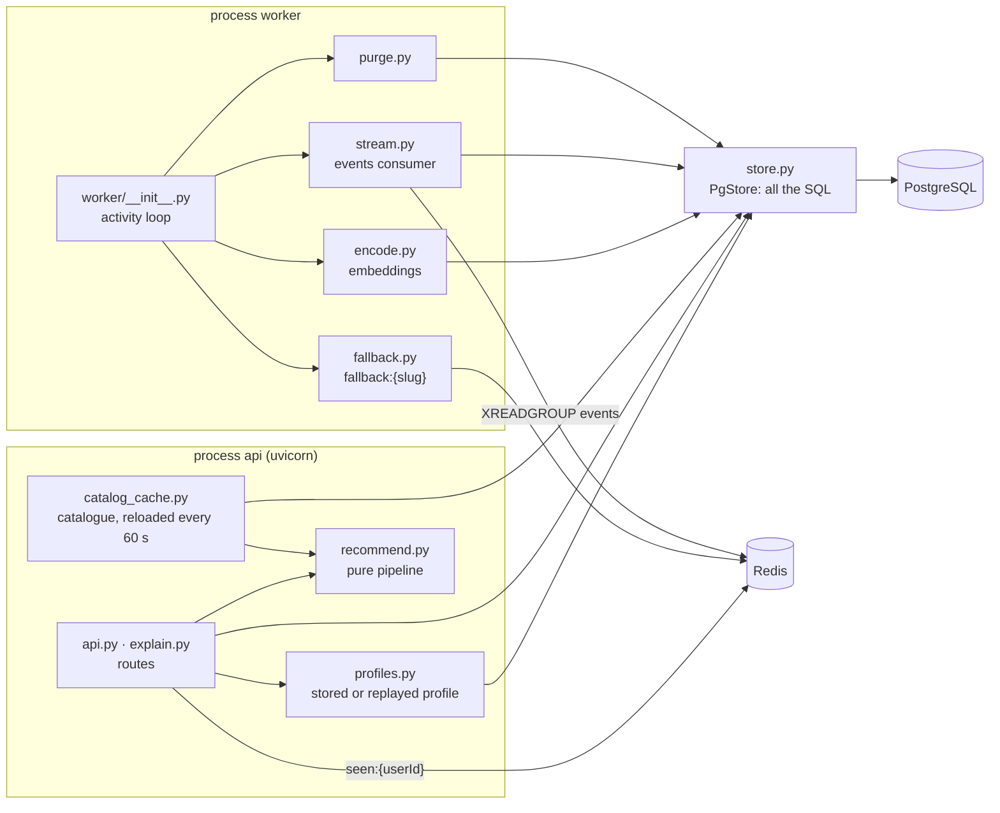

# Architecture

The recommender is one Python package, `swipread_reco`, run as two processes. The algorithm itself is a set of pure functions; everything that touches the database, Redis or the clock sits around it and is passed in.

## Components

| Process | Does | Started by |
| --- | --- | --- |
| `api` | Serves `POST /v1/recommendations`, the explanation routes and `/healthz`; keeps the catalogue in memory | `python -m swipread_reco api` |
| `worker` | Encodes new articles, writes the fallback lists, purges, reads the `events` stream | `python -m swipread_reco worker` |

Both create the recommender's tables if they are missing (`PgStore.ensure_schema`) and stop at start if the database lacks what the API's migrations create.

## Modules

| Module | Role | Pure |
| --- | --- | --- |
| `profile.py` | Replay of the events into weights and liked and rejected articles (`replay_profile`), echo topic (`echo_candidate`), age factor (`finish_profile`) | yes |
| `scoring.py` | Recentred similarity, closeness, freshness, rejection, `mu` | yes |
| `allocation.py` | Shares per topic with the 60 % cap, interleaving order, seed from the request id | yes |
| `assemble.py` | Candidates and filling of the batch: same story, varied sources, `reason`, explanation | yes |
| `recommend.py` | The pipeline: `RecoInput` in, `Lot` out | yes, but `fetch_embeddings` |
| `models.py`, `params.py` | Frozen data types; every tunable parameter (spec section 10) | yes |
| `profiles.py` | The stored profile if it is fresh, else a replay stored again | no |
| `store.py` | `Store` protocol and `PgStore`: the only module that holds SQL | no |
| `catalog_cache.py` | Catalogue reloaded in a background thread and swapped in whole | no |
| `api.py`, `explain.py` | FastAPI routes | no |
| `worker/` | Activity loop and its activities, stream consumer | no |
| `sim/` | Synthetic catalogue, simulated readers and backend, report for the jury | yes |

The pure core is what the acceptance tests (spec section 11) run without any infrastructure; `tests/fakes.py` implements the `Store` protocol in memory for the routes and the worker.

## A request

`POST /v1/recommendations` runs in a FastAPI worker thread (the handlers are synchronous):

1. `app.users.locale` of the reader: 404 if unknown.
2. The catalogue from the cache: an empty one answers `items: []` at once.
3. The exclusions: the request's `exclude`, Redis `seen:{userId}` (100 ms timeout; a failure is logged and the set skipped), `app.user_articles`.
4. Topics, chosen topics, time of the previous batch, events received since then (for the echo).
5. The profile from `profiles.current_profile`: the stored one if its mark and basis match, else a replay of `app.events` stored again.
6. `recommend`: profile finished at the request's clock, scores, shares, interleaving, filling.
7. The batch saved in `reco.feed_requests` and `reco.feed_items` in one transaction, then the response.

## Errors and timeouts

| Situation | Behaviour |
| --- | --- |
| Any `Store` call raises (database down, query error) | 503 `store unavailable`, logged with its traceback (`_GuardedStore`) |
| No pooled connection within `RECO_DB_TIMEOUT_S` (2 s) | Same, without waiting longer; lower it under the API's 300 ms timeout in production |
| Redis unreachable for `seen:{userId}` | The batch is computed without that exclusion; warning logged |
| Invalid request | 400 with the validation errors |
| Catalogue reload fails | The previous catalogue stays in use; logged |
| An activity of the worker fails | Logged; retried at its next period. The loop never stops on it |

## Worker loop

One thread, one loop: each activity runs at its own period (encoding every 15 s, fallback lists every 10 min, purge every hour, pending stream messages every minute), all at start. Between two activities the loop waits on the `events` stream (`XREADGROUP`, blocking at most 2 s, under the worker's 5 s Redis timeout), so a message is handled within moments. After an overrun, an activity runs again one period later instead of catching up in a burst. See [Flows](flows.md) for the stream.

## Identifiers and determinism

- `requestId`: `r_` followed by a UUID v4 in hexadecimal. Its SHA-256 gives the seed of the random offsets (spec 6.2): the same request on the same state and clock always gives the same batch.
- Ids of readers, articles and events are the API's (`u_…`, `a_…`, `e_…`).
- `modelVersion`: `topic-weights-v1`, saved with every batch and every stored profile.
