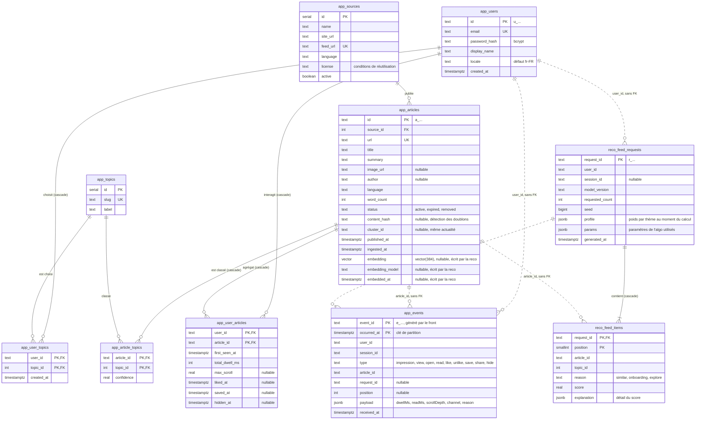

# Schéma de la base de données

Ce document fait foi pour le schéma. Il remplace l'ancien `database.md`, `database_1.md` et la section « Base de données » de [Contrat backend reco.md](Contrat%20backend%20reco.md). Il est aligné sur [api.md](api.md) pour les événements et sur [algo_reco.md](algo_reco.md) pour le schéma `reco`.

Une seule base PostgreSQL avec l'extension pgvector, découpée en deux schémas :

- `app` : données métier, écrites par le backend, l'ingestion et l'admin ;
- `reco` : données internes du service de recommandation.

## Diagramme



## Tables

| Table | Écrite par | Contenu |
| --- | --- | --- |
| `app.users` | backend | Comptes, langue préférée |
| `app.topics` | admin (seed en dev) | Thèmes proposés à l'onboarding |
| `app.user_topics` | backend | Thèmes choisis par chaque utilisateur (`PUT /v1/me/topics`) |
| `app.sources` | admin | Flux RSS ingérés, avec leur licence |
| `app.articles` | ingestion ; reco pour les trois colonnes d'embedding | Métadonnées, résumé, statut, embedding |
| `app.article_topics` | ingestion | Thèmes détectés par article, avec un score de confiance |
| `app.events` | backend | Historique brut des événements (`POST /v1/events`), partitionné par mois |
| `app.user_articles` | backend | État agrégé par couple utilisateur/article : vu, temps passé, liké, sauvegardé, masqué |
| `reco.feed_requests` | reco | Chaque lot calculé : utilisateur, version de l'algo, profil et paramètres utilisés |
| `reco.feed_items` | reco | Articles de chaque lot, avec position, thème, raison, score et détail du score |

`app.events` est la source de vérité : `app.user_articles` et le profil de reco se recalculent à partir d'elle. La reco ne stocke pas de profil utilisateur ; elle le rejoue depuis `app.events` à chaque demande (voir `algo_reco.md`, section 4).

## DDL

```sql
CREATE EXTENSION IF NOT EXISTS vector;
CREATE SCHEMA IF NOT EXISTS app;
CREATE SCHEMA IF NOT EXISTS reco;

CREATE TABLE app.users (
  id            text PRIMARY KEY,              -- u_...
  email         text NOT NULL UNIQUE,
  password_hash text NOT NULL,
  display_name  text NOT NULL,
  locale        text NOT NULL DEFAULT 'fr-FR',
  created_at    timestamptz NOT NULL DEFAULT now()
);

CREATE TABLE app.topics (
  id    serial PRIMARY KEY,
  slug  text NOT NULL UNIQUE,
  label text NOT NULL
);

CREATE TABLE app.user_topics (
  user_id    text REFERENCES app.users(id) ON DELETE CASCADE,
  topic_id   int  REFERENCES app.topics(id),
  created_at timestamptz NOT NULL DEFAULT now(),
  PRIMARY KEY (user_id, topic_id)
);

CREATE TABLE app.sources (
  id       serial PRIMARY KEY,
  name     text NOT NULL,
  site_url text NOT NULL,
  feed_url text NOT NULL UNIQUE,
  language text NOT NULL,
  license  text,
  active   boolean NOT NULL DEFAULT true
);

CREATE TABLE app.articles (
  id              text PRIMARY KEY,            -- a_...
  source_id       int  NOT NULL REFERENCES app.sources(id),
  url             text NOT NULL UNIQUE,
  title           text NOT NULL,
  summary         text NOT NULL,
  image_url       text,
  author          text,
  language        text NOT NULL,               -- code à deux lettres, ex. fr
  word_count      int  NOT NULL,
  status          text NOT NULL DEFAULT 'active'
                  CHECK (status IN ('active', 'expired', 'removed')),
  content_hash    text,
  cluster_id      text,
  published_at    timestamptz NOT NULL,
  ingested_at     timestamptz NOT NULL DEFAULT now(),
  embedding       vector(384),
  embedding_model text,
  embedded_at     timestamptz
);
CREATE INDEX articles_published_idx ON app.articles (published_at DESC);
CREATE INDEX articles_to_embed_idx ON app.articles (ingested_at DESC)
  WHERE embedding IS NULL;

CREATE TABLE app.article_topics (
  article_id text REFERENCES app.articles(id) ON DELETE CASCADE,
  topic_id   int  REFERENCES app.topics(id),
  confidence real NOT NULL,
  PRIMARY KEY (article_id, topic_id)
);

CREATE TABLE app.events (
  event_id    text NOT NULL,                   -- e_..., généré par le front
  user_id     text NOT NULL,
  session_id  text NOT NULL,
  type        text NOT NULL
              CHECK (type IN ('impression', 'view', 'open', 'read', 'like',
                              'unlike', 'save', 'share', 'hide')),
  article_id  text NOT NULL,
  request_id  text,
  position    int,
  payload     jsonb NOT NULL DEFAULT '{}',
  occurred_at timestamptz NOT NULL,
  received_at timestamptz NOT NULL DEFAULT now(),
  PRIMARY KEY (event_id, occurred_at)
) PARTITION BY RANGE (occurred_at);
CREATE INDEX events_user_idx ON app.events (user_id, occurred_at DESC);
CREATE INDEX events_request_idx ON app.events (request_id);

CREATE TABLE app.user_articles (
  user_id        text REFERENCES app.users(id) ON DELETE CASCADE,
  article_id     text REFERENCES app.articles(id) ON DELETE CASCADE,
  first_seen_at  timestamptz NOT NULL,
  total_dwell_ms int NOT NULL DEFAULT 0,
  max_scroll     real,
  liked_at       timestamptz,
  saved_at       timestamptz,
  hidden_at      timestamptz,
  PRIMARY KEY (user_id, article_id)
);
CREATE INDEX user_articles_saved_idx ON app.user_articles (user_id, saved_at DESC)
  WHERE saved_at IS NOT NULL;

CREATE TABLE reco.feed_requests (
  request_id      text PRIMARY KEY,            -- r_...
  user_id         text NOT NULL,
  session_id      text,
  model_version   text NOT NULL,
  requested_count int  NOT NULL,
  seed            bigint NOT NULL,
  profile         jsonb NOT NULL,
  params          jsonb NOT NULL,
  generated_at    timestamptz NOT NULL DEFAULT now()
);
CREATE INDEX feed_requests_user_idx
  ON reco.feed_requests (user_id, generated_at DESC);

CREATE TABLE reco.feed_items (
  request_id  text REFERENCES reco.feed_requests(request_id) ON DELETE CASCADE,
  position    smallint,
  article_id  text NOT NULL,
  topic_id    int  NOT NULL,
  reason      text NOT NULL,
  score       real NOT NULL,
  explanation jsonb NOT NULL,
  PRIMARY KEY (request_id, position)
);
```

Le contenu des colonnes `jsonb` de `reco` est décrit dans `algo_reco.md`, section 9. Le payload de `app.events` suit `api.md` : `dwellMs` pour `view`, `readMs` et `scrollDepth` pour `read`, `channel` pour `share`, `reason` pour `hide`.

## Droits

| Rôle | `app` | `reco` |
| --- | --- | --- |
| backend | lecture et écriture | aucun |
| ingestion | lecture ; écriture sur `articles` et `article_topics` | aucun |
| reco | lecture seule, plus `UPDATE (embedding, embedding_model, embedded_at)` sur `app.articles` | lecture et écriture ; crée ses tables au démarrage |

## Points de vigilance

- Pas de clé étrangère sur `app.events` : l'insertion doit rester rapide, et un article supprimé ne doit pas effacer l'historique.
- Une partition de `app.events` par mois ; un job mensuel crée la suivante (ou l'extension pg_partman).
- Il n'y a pas d'index vectoriel sur `app.articles.embedding` : la reco calcule les ressemblances en mémoire, de façon exacte. Un index HNSW ne devient utile qu'au-delà d'environ 100 000 articles.
- La reco supprime les lignes de `reco.feed_requests` de plus de 30 jours et celles des utilisateurs absents de `app.users`.

## Ce qui a été retiré par rapport à `database_1.md`

| Retiré | Raison |
| --- | --- |
| `app.users.personalization_consent_at`, `app.users.deleted_at` | Aucun endpoint de `api.md` ne les renseigne. À rajouter avec la suppression de compte (US16). |
| `app.events.dwell_ms`, type `card_view` | `api.md` utilise le type `view` et `payload.dwellMs`. |
| Colonnes ajoutées à `app.user_articles` (`impressions`, `card_dwell_ms`, `opened_at`, `read_dwell_ms`, `last_seen_at`) | Retour à la version du contrat ; la reco ne lit plus ces colonnes. |
| `reco.user_profiles`, `reco.user_interests`, `reco.article_stats`, `reco.model_runs` | Le profil est rejoué depuis `app.events` ; pas de statistiques de popularité ni d'entraînement en v1. |
| Index HNSW sur `embedding` | Voir les points de vigilance. |
