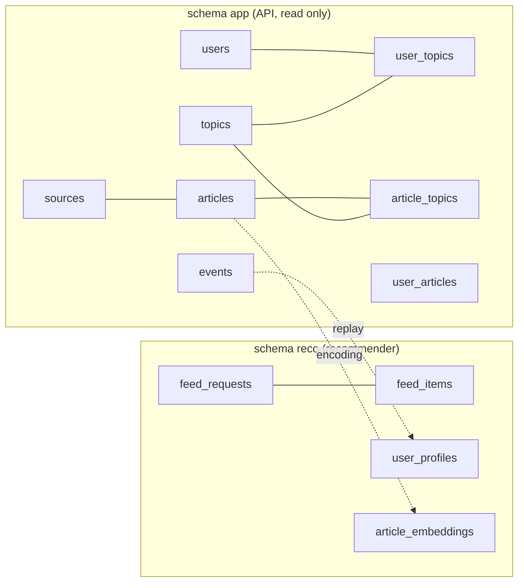

# Database

The `app` schema, the `vector` extension and the `reco` schema are created by the API's Flyway migrations: they are the reference, described in the [database page of Swipread/api](https://github.com/Swipread/api/blob/main/docs/database.md). This page lists only what the recommender reads from `app`, the tables it creates in `reco` and the rights it needs. Aligned with Swipread/api at commit 48055c3 (migrations V1 to V8).

For the tests, `sql/app_schema.sql` copies these migrations; keep it up to date with each new migration of the API.



## What the recommender reads in `app`

Read only; the recommender never writes to `app`.

| Table | Columns read | Use |
| --- | --- | --- |
| `app.users` | `id`, `locale` | Known user (404 otherwise), default language; purge of the batches and profiles of deleted accounts |
| `app.topics` | `id`, `slug`, `label` | List of topics, slugs of the `fallback:{slug}` lists |
| `app.user_topics` | `user_id`, `topic_id` | Chosen topics |
| `app.sources` | `id`, `active` | Only the articles of active sources are recommendable |
| `app.articles` | `id`, `source_id`, `title`, `summary`, `language`, `word_count`, `published_at`, `ingested_at` | Catalogue, encoding, titles of the explanation routes. `embedding` is neither read nor written |
| `app.article_topics` | `article_id`, `topic_id`, `confidence` | Main topic of an article |
| `app.events` | `event_id`, `user_id`, `type`, `article_id`, `payload`, `occurred_at`, `received_at` | Replay of the profile and mark of `reco.user_profiles`. Types read: `view`, `open`, `read`, `like`, `unlike`, `save`, `unsave`, `share`, `hide`; rows without `article_id` are ignored |
| `app.user_articles` | `user_id`, `article_id` | Articles the reader already met, left out of the batches |

The API has neither an article status nor a `cluster_id`: every article of an active source is active, and the "same story" rule rests on similarity alone ([specification](algo_reco.md), 7.2).

## Tables of `reco`

Created by the service at start (`PgStore.ensure_schema`), if they do not exist. The `reco` schema must exist (API migration V1): the service does not create it and stops with an explicit message if it is missing, if the `vector` type is missing, or if `reco.user_profiles` is still the API's old table (created by V1, dropped by its migration V8: run the API's migrations first).

```sql
CREATE TABLE IF NOT EXISTS reco.feed_requests (
  request_id      text PRIMARY KEY,            -- r_...
  user_id         text NOT NULL,
  session_id      text,
  model_version   text NOT NULL,
  requested_count int  NOT NULL,
  seed            bigint NOT NULL,
  profile         jsonb NOT NULL,
  params          jsonb NOT NULL,
  generated_at    timestamptz NOT NULL DEFAULT now()
);
CREATE INDEX IF NOT EXISTS feed_requests_user_idx
  ON reco.feed_requests (user_id, generated_at DESC);

CREATE TABLE IF NOT EXISTS reco.feed_items (
  request_id  text REFERENCES reco.feed_requests(request_id) ON DELETE CASCADE,
  position    smallint,
  article_id  text NOT NULL,
  topic_id    int  NOT NULL,
  reason      text NOT NULL,
  score       real NOT NULL,
  explanation jsonb NOT NULL,
  PRIMARY KEY (request_id, position)
);

CREATE TABLE IF NOT EXISTS reco.user_profiles (
  user_id          text PRIMARY KEY,
  basis            jsonb NOT NULL,             -- what the replay depends on, events aside
  state            jsonb NOT NULL,             -- result of the replay
  events_count     int  NOT NULL,              -- mark: number of events replayed
  last_occurred_at timestamptz,                -- mark: last event (contract v1.5)
  last_event_id    text,
  computed_at      timestamptz NOT NULL
);

CREATE TABLE IF NOT EXISTS reco.article_embeddings (
  article_id  text PRIMARY KEY,                -- no foreign key: no REFERENCES right on app
  embedding   vector(384) NOT NULL,
  model       text NOT NULL,
  embedded_at timestamptz NOT NULL
);
```

- `feed_requests` and `feed_items`: each batch computed and its cards; content of the `jsonb` columns in the [specification](algo_reco.md), section 9.
- `article_embeddings`: one embedding per article, written by the worker. Only the rows of the current model (`multilingual-e5-small`) are read; a row of another model is encoded again and replaced (specification, 8.4).
- `user_profiles` (contract v1.5, specification 8.6): each reader's profile, kept up to date by the worker from the `events` stream and checked at each request. It is used only if its mark and basis are those of the moment; otherwise it is replayed from `app.events` and replaced.
  - Mark: `events_count`, `last_occurred_at` and `last_event_id` of the reader's events that count for the profile (types of specification 4.1, with an article).
  - `basis`: `{ "modelVersion": …, "params": {parameters of section 10}, "topics": [ids of app.topics], "chosen": [chosen ids, sorted] }`.
  - `state`: `{ "weights": [[topicId, weight]…], "liked": [[articleId, strength, lastEvent]…], "rejected": […], "touched": [articleIds], "history": [[eventId, type, articleId, topicId, δ, weightAfter, occurredAt]…] }`. Lists rather than objects wherever order matters: `jsonb` does not keep the order of keys. The strengths are those before the age factor; `history` keeps the last 50 weight changes.
  - Deleted at once on `user_deleted`, and at the hourly purge if the reader is no longer in `app.users`.
- Hourly purge (specification, 8.7): batches older than 30 days or of users absent from `app.users`, profiles of users absent from `app.users`, embeddings of articles absent from `app.articles`.

The API creates no table in `reco` since its migration V8, which dropped the `reco.user_profiles` and `reco.model_runs` of its migration V1, never used.

## Rights

The service connects with a login role member of the group role `swipread_reco`, created by the API's migration V5:

```sql
CREATE ROLE reco_service LOGIN PASSWORD '…' IN ROLE swipread_reco;
```

| Schema | Rights of `swipread_reco` (V5) | Used by the recommender |
| --- | --- | --- |
| `app` | `USAGE`; `SELECT` on every table, except `app.users` limited to `id`, `locale`, `created_at`; nothing on `app.event_outbox` or `app.refresh_tokens` | `SELECT` on the columns listed above |
| `reco` | `USAGE`, `CREATE`; `SELECT`, `INSERT`, `UPDATE`, `DELETE` on the tables | Creation of its four tables, read and write |
| database | no `CREATE` | none: the service creates neither a schema nor an extension |

The integration tests check it: they connect with a role `reco_test` member of `swipread_reco`, on a copy of the API's migrations.
