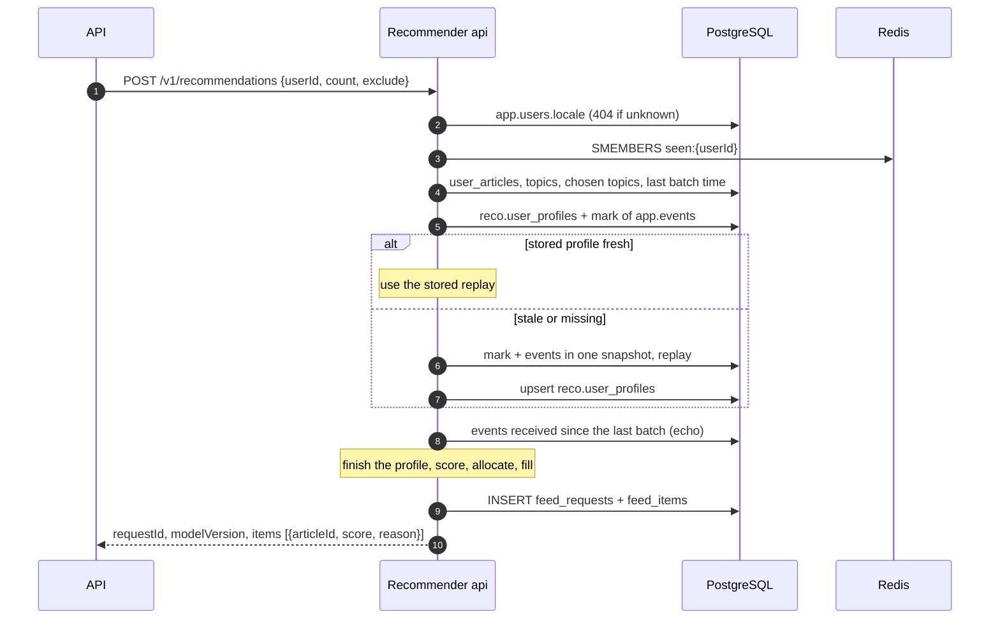
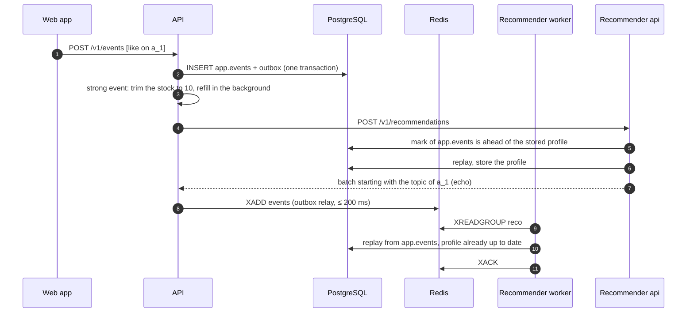
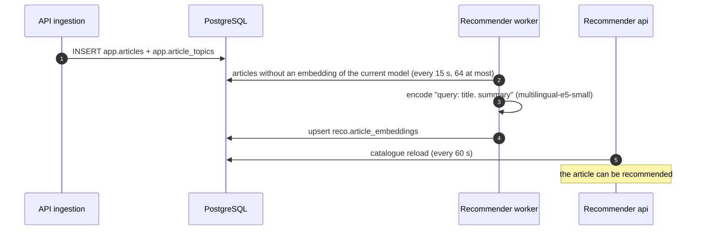
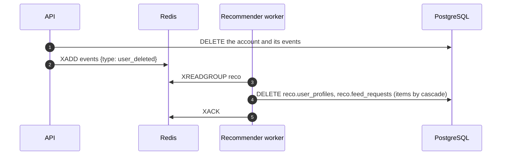

# Flows

The main sequences between the API and the recommender. The details of each rule are in the [algorithm](algorithm.md).

## A batch for a reader

The API keeps the batch in the reader's stock and serves it page by page; the recommender only sees the next call, with the cards still in stock as `exclude`.

## A strong signal

The refill often arrives before the stream message: the mark check makes the request replay, so the like is in the batch either way. The worker's later refresh gives the same profile.

## A weak signal

A `view`, `open` or non-complete `read` does not make the API refill. The worker reads its message and stores the new profile; the next batch, whenever it comes, finds it fresh and skips the replay.

## A new article

An article is recommendable at most about 75 seconds after its ingestion, encoding time aside, while it is less than 14 days old (`MAX_AGE_DAYS`) and its source is active. Every 10 minutes the worker also rewrites the fallback lists `fallback:{slug}` the API serves when the recommender is down.

## A deleted account

If the deletion fails, the message stays pending and the worker takes it again every minute. The hourly purge also deletes the batches and profiles of any account gone from `app.users`.
